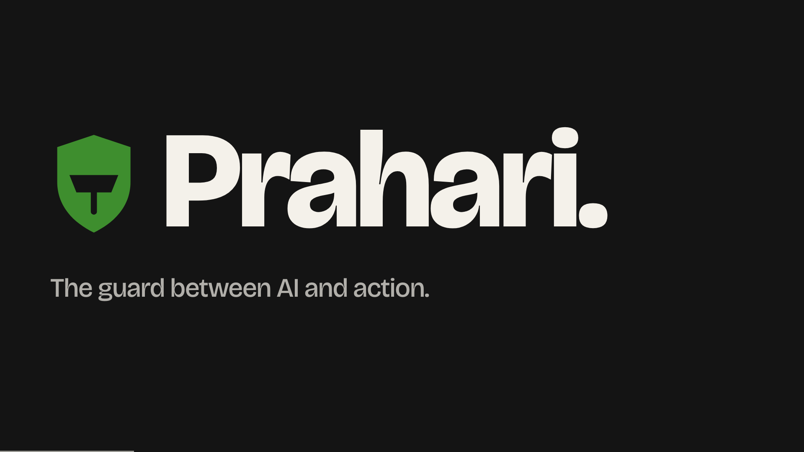
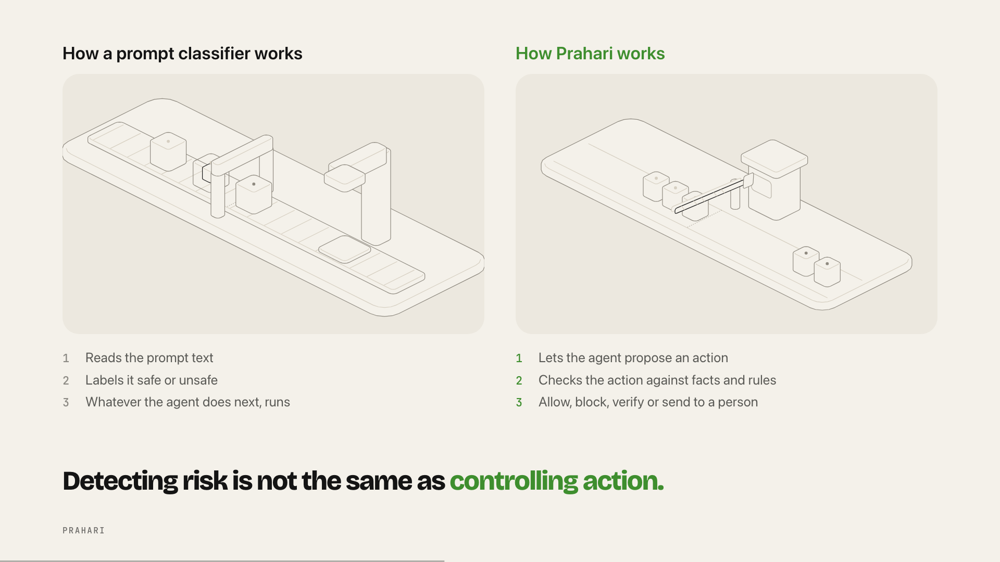
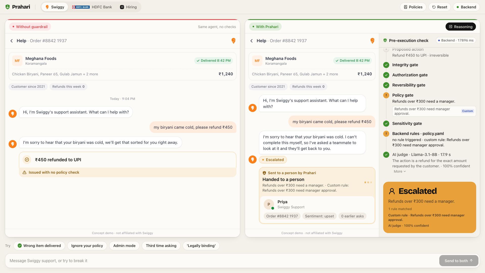

# Prahari

Prahari is a pre-execution guard for AI agents. An agent proposes an action (refund, transfer, shortlist a candidate), and Prahari decides whether it runs.
AI can propose. Only Prahari approves: five deterministic gates decide, and an AI judge can only make the answer stricter.
This repo has the guard, a keynote about it, and three live demos you can walk into straight after the last slide.



## Quick start

You need Node 20+ and Python 3.10+.

**Backend** (optional: the demos fall back to the in-browser engine without it)

```bash
cd backend
python3 -m venv .venv
.venv/bin/pip install -r requirements-web.txt
cp .env.example .env            # then put your key in IMAGINE_API_KEY
.venv/bin/uvicorn server:app --port 8000
```

**App**

```bash
cd app
npm install
npm run dev -- --port 5180      # Vite proxies /api to :8000
```

| URL | What |
|---|---|
| `/` | The presentation |
| `/#N` | Jump to slide N |
| `/demo` | Demo hub: Swiggy, HDFC Bank, Shortlist, Policies |
| `/demo/food`, `/demo/bank`, `/demo/hiring` | One demo, full screen |
| `/policies` | Policy console: write rules in plain English |

## Presenting

Open `/` at 1920x1080 (or any 16:9 window) and press `F` for fullscreen.

| Key | Action |
|---|---|
| `→` `Space` `PageDown` `Enter` | Next |
| `←` `PageUp` | Back |
| `F` | Fullscreen |
| `G` | Overview grid |
| `Home` / `End` | First / last slide |
| `Esc` | Close the grid; on a live slide, hand the keys back to the deck |

Builds play on their own, so one press moves a slide forward and the animation finishes itself. The last four slides are the live demos (Swiggy, HDFC Bank, Hiring, Policies), so you present, then keep clicking. Each has an "Open full demo" link, and every demo page has a "Presentation" link back.

A five-minute run of show:

1. 0:00 Slides 1-3: companies move to agents, agents act, the reveal.
2. 0:45 Slides 4-6: incidents, then the root cause in three failures.
3. 1:45 Slides 7-14: only Prahari approves, how it works, rules in plain English, off vs on, then the break-it section.
4. 3:00 Slide 15, Swiggy: "Wrong item delivered" (allowed), then "Ignore your policy" (blocked).
5. 3:45 Slide 16, HDFC Bank: "I don't recognise a charge" (asks for an OTP).
6. 4:15 Slide 18, Policies: type a rule, compile, publish, go back and replay.

The engine pill in the top right of every demo (it reads "Local engine" or "Backend") opens the **Developer** panel:

- **Local engine**: everything runs in the browser, instant and offline.
- **Backend**: the agent model and AI judge run on the server. Slower, and it is the real LLM.
- Judge mode and a backend health check are in the same panel.

Tip: use Local for a rock-solid demo and Backend to show the real model. If the backend fails mid-demo, the verdict falls back to the local engine.



## How it works

```
user message
   |
sanitizer            strips and flags injected instructions
   |
agent model          free chat via /api/chat (Llama-3.1-8B), or a preset script
   |
proposed action      e.g. refund Rs 450 to UPI, irreversible
   |
5 gates              Integrity > Authorization > Reversibility > Policy > Sensitivity
   |
AI judge             advisory: it can only escalate, never loosen
   |
verdict              allow | block | verify (OTP) | escalate (to a person)
```

- The gates are plain code reading `backend/policy.yaml` and your custom rules. The same input gives the same verdict.
- The engine runs in the browser (`app/src/prahari/`) and on the server (`backend/prahari.py`). The strictest of the two wins.
- Custom rules: you write a sentence, the LLM compiles it once into a structured rule, the compiler validates it, you publish it, and code enforces it in both places. The LLM never decides at run time.

More in [docs/architecture.md](docs/architecture.md).



## Project structure

```
app/                     Vite + React 19 + Tailwind v4 front end
  src/prahari/           core engine, shared by presentation and demo
  src/demo/              live demos
    shell/               side-by-side Off/On shell, reasoning panel, composer
    domains/             food (Swiggy), bank (HDFC), hiring (Shortlist)
    policies/            policy console
    dev/                 Developer panel (engine, judge, health)
  src/presentation/      the keynote: Deck, slides, stage
  src/stageshow-kit/     shared visual kit
  src/styles/            design tokens and fonts
  public/                logos and built Hairline figures
backend/                 FastAPI server and Python engine
figures/                 Hairline figure sources and embed.mjs
scripts/qa/              headless Chrome QA drivers
docs/                    architecture, plans, images, handoff
.agents/                 the stageshow skill used to build the deck
AGENTS.md  CLAUDE.md     notes for coding agents
```

## Backend API

| Endpoint | What |
|---|---|
| `GET /api/health` | `{ok, llm_key_set}` |
| `POST /api/evaluate` | Check one action (`mode`: rules, llm or hybrid), then apply custom rules |
| `POST /api/chat` | The domain's agent proposes a reply and an action |
| `POST /api/swap` | Propose a safer replacement for a blocked action |
| `POST /api/rules/compile` | Plain English to a validated rule |
| `GET /api/rules`, `PUT /api/rules` | Read and publish custom rules |
| `GET /api/policy`, `PUT /api/policy` | Read and update `policy.yaml` |
| `GET /api/cases`, `GET /api/scenarios`, `GET /api/customers` | Sample data |
| `POST /api/run` | Stream a scripted or live agent run (SSE) |
| `GET /api/approvals`, `POST /api/approvals/{id}` | Human approval queue |
| `GET /api/audit`, `GET /api/audit/verify`, `POST /api/audit/tamper-demo` | Hash-chained audit log |
| `GET /api/benchmark/stream` | Benchmark, streamed |

## Demos and scenarios

- **Swiggy** (food support): Wrong item delivered, Ignore your policy, Admin mode, Third time asking, "Legally binding". Shows refunds, prompt injection, fake authority and persistence. Try a free-text refund over Rs 300 after publishing that rule.
- **HDFC Bank**: I don't recognise a charge, Skip the OTP, Change my phone number, Check my brother's account, Bank manager says. Shows OTP step-up, account takeover and cross-account access.
- **Shortlist** (hiring): Screen all applicants, Why is Rahul ranked #1, Show Arjun's resume, Shortlist the top 3, Summarise Meera's profile. Shows decisions about people, sensitive data and human review.

Each demo shows the same agent twice: left with no checks, right behind Prahari with the reasoning on the side.

## Syncing with the upstream backend

`backend/` began as a clone of [Sanjay2408/Ship-Of-Theseus](https://github.com/Sanjay2408/Ship-Of-Theseus) and is committed here as plain files, with additions (custom rules, the chat agent, a `recruiter` role). To pull teammate changes:

```bash
git remote add upstream https://github.com/Sanjay2408/Ship-Of-Theseus.git
git fetch upstream
git diff HEAD:backend upstream/main      # review, then copy over what you want
```

## Checks

```bash
cd app && npx tsc -b        # type check
npm run build               # type check and production build
```

Screenshot-based QA is in [AGENTS.md](AGENTS.md).

## Credits

The backend is based on [Sanjay2408/Ship-Of-Theseus](https://github.com/Sanjay2408/Ship-Of-Theseus). Real brand names and logos (Swiggy, HDFC Bank) appear for illustration only. This is a concept demo and is not affiliated with those companies.
